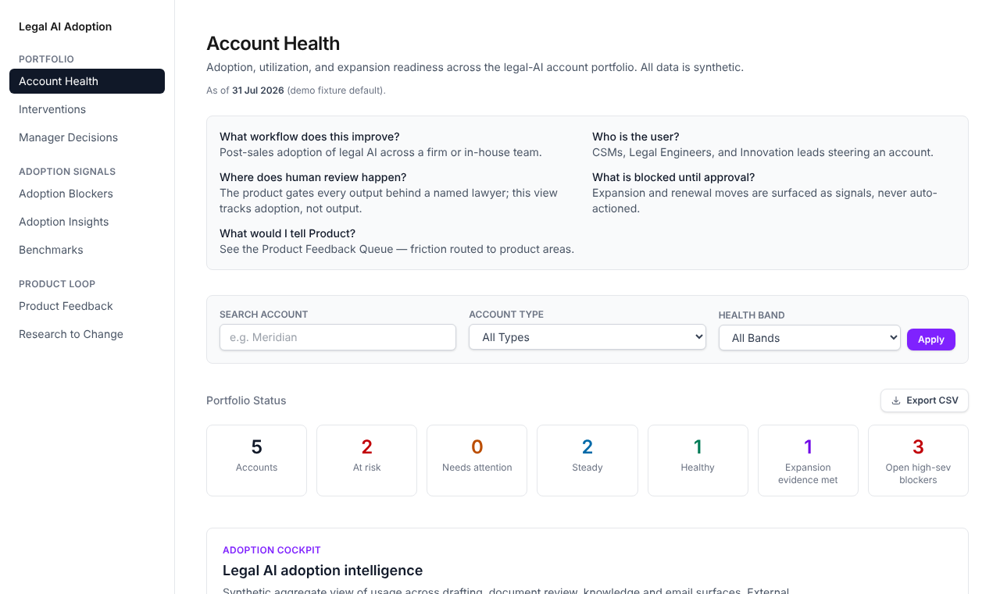
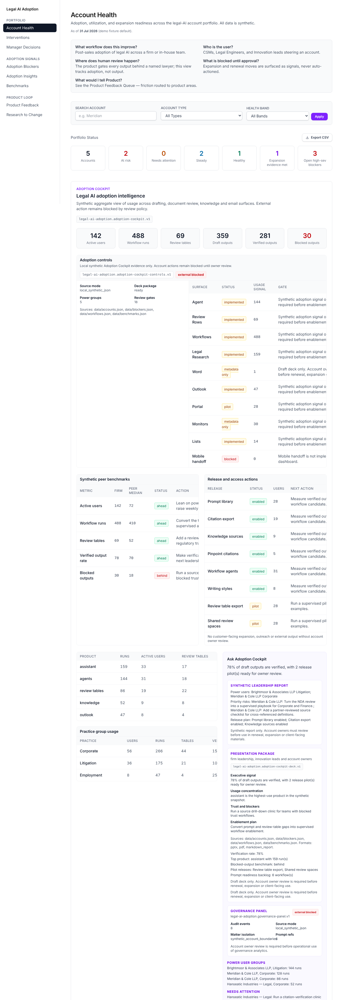
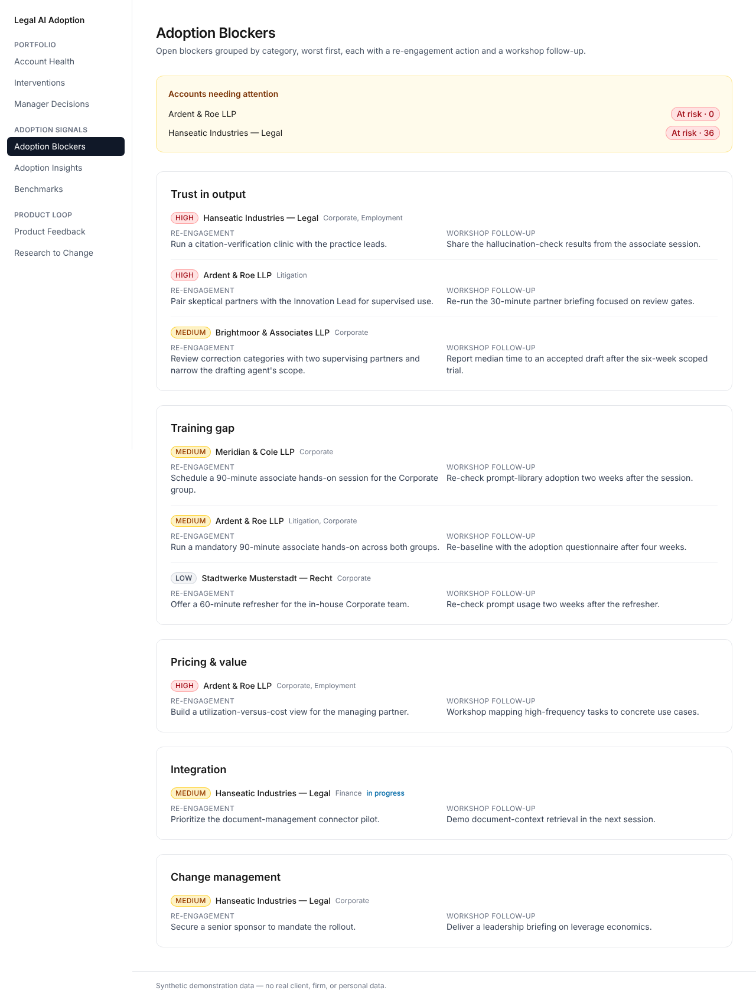
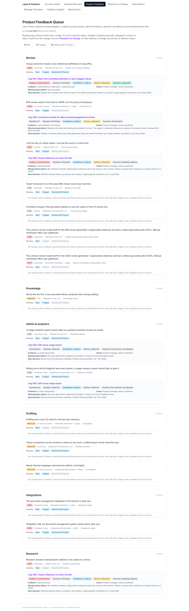

# Legal AI Adoption Dashboard

[](https://github.com/sebastianfoerste/legal-ai-adoption-dashboard/actions/workflows/ci.yml)

Deterministic tests cover health scoring, adoption denominators, intervention states, the value verdict, expansion decisions, Adoption Cockpit analytics and synthetic data contracts.

See [CASE_STUDY.md](CASE_STUDY.md) for what the project demonstrates and its limits, and [docs/DEMO_GUIDE.md](docs/DEMO_GUIDE.md) for a ten-minute walk-through.



*Screenshot of the running app (`pnpm build && pnpm start`), top of the Account Health page (`/`), synthetic data.*

A mock dashboard for steering legal-AI adoption inside a law firm or in-house team.
It shows how a Customer Success Manager, Legal Engineer, or Innovation lead watches
adoption, catches accounts before they stall, and turns user friction into product
feedback. All data is synthetic.

The Adoption Cockpit adds a local synthetic review summary: which product areas are
used, which evidence files support the deck, which actions remain blocked, and
which account-owner review gate applies before any renewal or expansion move.

The engagement layer adds what a manager of legal engineers needs after the sale:
intervention tracking from observed problem to evaluated outcome, adoption over time with
stated denominators, customer value measured as time to an acceptable result, a manager
view of assignments, capacity, overdue commitments, escalations and coaching, evidence-based
expansion readiness, and a customer review report. Two synthetic scenarios run through all
of it: an account whose stalled adoption was diagnosed and recovered, and a heavily used
account where expansion is inappropriate.

**Public-safety posture:** synthetic account data only, source provenance for dashboard inputs, review-gated legal outputs, and no legal advice.

**Live demo:** https://legal-ai-adoption-dashboard.vercel.app

**Run locally:** `pnpm install && pnpm dev`.


> **What workflow does this improve?** Post-sales adoption of legal AI across a firm or in-house team.
> **Who is the user?** CSMs, Legal Engineers, and Innovation leads steering an account.
> **Where does human review happen?** The product gates every output behind a named lawyer. This dashboard tracks adoption, not output.
> **What is blocked until approval?** Expansion and renewal moves are surfaced as signals, never auto-actioned.
> **What would I tell Product?** See the Product Feedback Queue: friction routed to product areas.

## Pilot-to-adoption path

This is the legal-AI platform adoption path:

1. **Onboarding:** start in Account Health to see which teams are active and which practice groups are drifting.
2. **Blocker diagnosis:** open Adoption Blockers to identify training gaps, workflow mismatch, stakeholder resistance, or missing precedent coverage.
3. **Intervention:** record the observed problem, its evidence, a hypothesis, the action and the expected result in Interventions. A delivered action stays "completed, not evaluated" until follow-up observations are compared with the expected result.
4. **Adoption over time:** read activation, repeat use, completed workflows and drop-off after training per reporting period on the account page, each as numerator of denominator.
5. **Customer value:** compare time to an acceptable result before and after, review and correction included, beside quality failures and rework.
6. **Product feedback:** route observed friction to the Product Feedback Queue with severity, product area, and customer impact. Routing is not counted as customer value.
7. **Manager decisions:** see why each account receives attention, who is assigned, and where capacity, commitments or escalations need a decision.
8. **Customer review:** open the review report for objectives, trends, outcomes, unresolved problems and a recommendation to expand, continue, adjust or pause.
9. **Adoption profile:** inspect the Adoption Cockpit coverage table before turning any synthetic insight into a leadership deck or account action.

## Problem

A legal-AI rollout does not fail at the demo. It fails three months later, when two
practice groups quietly stop logging in and nobody notices until renewal. The work of
adoption has no home: spotting the dip, naming the blocker, scheduling the right
workshop, and routing the right feedback to Product. This dashboard is that home.

## Target user

A Legal Engineer or CSM who owns a portfolio of firm and in-house accounts and is
measured on utilization, expansion, and renewal, not on shipping code.

## What this proves

- I model adoption as data: a health score over licence use, trend, reviewed output and blockers, with every denominator stated.
- I separate a delivered action from an achieved outcome: an intervention counts as a success only after follow-up observations are evaluated against the expected result.
- I separate use from value: expansion rests on six evidence criteria, and a healthy, busy account can still receive "adjust".
- I separate what was observed from what is assumed: a before-and-after improvement is reported as observed, its cause as an assumption, and any EUR figure prints its assumptions.
- I show missing data as unknown: an uncaptured count is never a zero and never a pass.
- I manage on recorded reasons: the manager view explains why an account needs attention, and specialists are never ranked by account count or activity.
- I translate user friction into product requirements: the feedback queue is the artifact you hand to Product and Engineering.
- I keep the human-review gate explicit: this tracks adoption of a reviewed product, never autonomous legal advice.

## Demo path

```bash
pnpm install
pnpm dev          # http://localhost:3000
pnpm test         # the adoption health score and data layer are unit-tested
```

Pages:

1. **Account Health** (`/`): a portfolio overview strip (accounts by band, accounts whose expansion evidence is met, open high-severity blockers), then per-account health with a score breakdown, the review recommendation, practice groups, persona adoption, and the weekly-active trend.
2. **Account detail** (`/accounts/[id]`): expansion readiness with supporting and missing evidence, the renewal decision aid, adoption over time, customer value and the account's interventions.
3. **Customer review** (`/accounts/[id]/review`): the seven-section review report; `/insights/report?account=<id>` downloads it as Markdown.
4. **Adoption Blockers** (`/blockers`): open blockers by category, worst first, each with a re-engagement action and a workshop follow-up.
5. **Product Feedback Queue** (`/feedback`): user friction routed to product areas, with a triage pipeline.
6. **Interventions** (`/interventions`): every intervention by stage: proposed, underway, completed and not evaluated, evaluated.
7. **Manager Decisions** (`/manager`): why each account receives attention, specialist assignments against capacity and complexity, overdue commitments, escalations, coaching actions and expansion readiness across accounts.
8. **Adoption Cockpit review summary** (`/`): synthetic product-surface coverage, review gates, deck package readiness and blocked external action status.
9. **Adoption Insights** (`/insights`): constrained adoption analytics, review-gated capability recommendations, the customer review reports and a filterable leadership report package.

The two scenarios are Stadtwerke Musterstadt (`/accounts/acct-005`, scenario A) and Brightmoor & Associates (`/accounts/acct-004`, scenario B). [docs/DEMO_GUIDE.md](docs/DEMO_GUIDE.md) walks through both in ten minutes.

## How the scores and recommendations work

**Adoption health** (`lib/health.ts`) is 45% licence use (active users of licensed seats), 25% usage trend and 30% reviewed completion (draft outputs a human reviewer verified), minus a penalty for open blockers. A component that was not captured is unknown: it is left out and the remaining weights are rescaled. Feedback routed to Product is not an input. Health is a triage aid and decides nothing about expansion.

**Expansion readiness** (`lib/engagement/expansion.ts`) checks six criteria, each met, not met or unknown: demonstrated workflow value, sustained use, no unresolved blocker in the way, customer demand, sponsor support and delivery capacity. All six met gives "expand". Sponsor support not met gives "pause". Value, sustained use or the blocker criterion not met gives "adjust". Anything else, including any unknown, gives "continue". The result is a recommendation for the account owner.

**Renewal** (`lib/engagement/renewal.ts`) is a decision aid: it lists recorded signals and suggests when to hold a human review. It outputs no probability.

## Screenshots

Screenshots of the running app (`pnpm build && pnpm start`) with the synthetic data in `data/`, captured on 13 October 2026.

**Account Health** (`/`), per-account cards; the Adoption Cockpit panel above them is not shown



**Adoption Blockers** (`/blockers`), full page



**Product Feedback Queue** (`/feedback`), full page



## Synthetic data statement

Every record in `data/` is synthetic and exists only for demonstration. No real client,
firm, or in-house team is represented; account names are invented. No personal data.
See [`data/README.md`](data/README.md).

## How a Legal Engineer would use this in a customer meeting

Open the customer review for the account at the start of a quarterly review. For the
synthetic Stadtwerke Musterstadt account it shows three objectives met, repeat use at six to
seven of eight eligible lawyers over three complete periods, and median time to a
signed-off result down from 167.5 to 90 active minutes with fewer quality failures
and 30 of 31 attempts accepted against 10 of 12 before. You say what
was observed, then what is assumed: the cohort is small, there was no comparison group,
and a product release landed in the same window. The recommendation is a bounded
expansion after a one-period pilot, with a named owner and a review date.

Correction, 6 October 2026: earlier versions of this document gave 150 and 80 minutes for this account. Those figures were the sum of three component medians, which is not a median. The figures here are medians of per-task totals. See [the measurement dictionary](docs/MEASUREMENT_DICTIONARY.md).

For Brightmoor & Associates the same report argues the other way. The customer wants 40
more seats and the account is the healthiest in the book, yet fewer than a third of
started drafting runs reach an accepted draft and time to an accepted draft has risen.
You show the evidence, name what is missing, and propose the scoped trial before any
commercial conversation.

## Limitations

The Adoption Insights validates synthetic `legal-workflow.event.v1` bundles and reports workflow-version adoption, review latency, comment resolution, lock contention, reviewer coverage and permission-governance alerts. The telemetry contract rejects document text, comments, names and client identifiers. The dashboard remains analytical and cannot mutate permissions in another app.

The versioned contract is maintained in `packages/legal-workflow-contract`. Dashboard analytics consume its typed Zod schema, and the standalone validator consumes its JSON Schema allowlist. The facilitation content is maintained in `workshop-kit` and retains its own `make check` gate. Run `make dashboard-check`, `make contract-check` and `make workshop-check` independently, or run `make check` for the combined gate.

- The health score is a deliberately simple, transparent formula (see `lib/health.ts`), not a tuned model.
- Practice-group health uses licence use and trend only. Reviewed output is not captured per group, so that component is unknown and left out.
- The engagement thresholds are uncalibrated judgment calls: ten for a small cohort or sample, 50% of eligible users over three periods for sustained use, 10% for a time improvement. Medians are compared without a significance test.
- A before-and-after comparison cannot establish that an intervention caused a change. The reports say so; they cannot repair it.
- Capacity hours and complexity points are planning assumptions. The engagement views use one fixed as-of date, 31 July 2026.
- Data is static JSON. There is no persistence, auth, or multi-tenancy. This is an MVP that demonstrates the workflow, not a product. See [CASE_STUDY.md](CASE_STUDY.md) for the full list of limits.

## Stack

Next.js (App Router, Server Components), TypeScript (strict), Tailwind, Zod for data
validation, Vitest for the logic tests.
