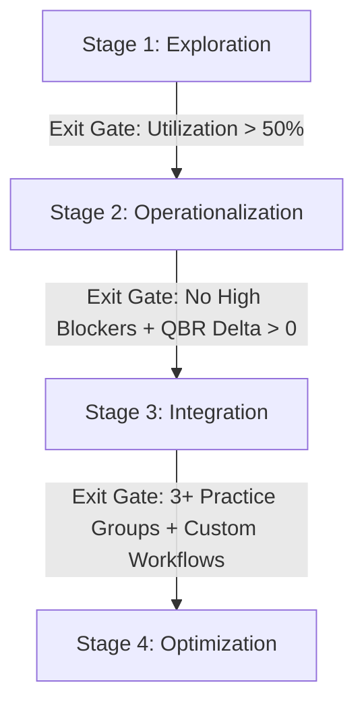

# Legal AI Workshop Kit — Unified Playbook

*This is a single unified file compiling all discovery tools, workshop agendas, and post-sales playbooks in the Legal AI Workshop Kit.*

---

## Table of Contents

- [legal-ai-workshop-kit](#readme)
- [What this proves](#what-this-proves)
- [Reviewer guide](#docs-reviewer-guide)
- [Customer workflow](#docs-customer-workflow)
- [Product-feedback notes](#docs-product-feedback-notes)
- [Adoption questionnaire](#discovery-adoption-questionnaire)
- [Workflow discovery template](#discovery-workflow-discovery-template)
- [Use-case prioritization matrix](#discovery-use-case-prioritization-matrix)
- [Legal AI ROI Calculation Worksheet](#discovery-roi-calculator)
- [Pilot success metrics](#discovery-pilot-success-metrics)
- [30-minute partner briefing](#sessions-30-min-partner-briefing)
- [60-minute workshop agenda](#sessions-60-min-workshop-agenda)
- [90-minute associate hands-on](#sessions-90-min-associate-hands-on)
- [Partnergespräch in 30 Minuten](#sessions-30-min-partner-briefing-de)
- [Legal AI Adoption Maturity Model Playbook](#enablement-adoption-maturity-model)
- [Skeptical-partner objection handling](#enablement-skeptical-partner-objections)
- [Follow-up email templates](#enablement-follow-up-email-templates)
- [Product-feedback template](#enablement-product-feedback-template)
- [Demo quality rubric](#team-demo-quality-rubric)
- [Discovery question bank by practice group](#team-discovery-question-bank)
- [Onboarding plan for a new legal engineer](#team-legal-engineer-onboarding-plan)

---

<div id="readme">


## legal-ai-workshop-kit


Enablement materials for rolling out a legal-AI tool in a law firm or an in-house legal team: partner briefings, associate hands-on sessions, adoption questionnaires, workflow discovery, prioritization matrices, product-feedback templates, and rollout follow-up materials.

The kit is for the people who run such a rollout: Legal Engineers, Customer Success Managers and innovation leads who prepare the sessions, work with the partners and associates who will use the tool, and report friction back to the product team.

All examples are synthetic. The repository is a public-safe portfolio project and does not provide legal advice.

## Run it

```bash
git clone https://github.com/sebastianfoerste/legal-ai-workshop-kit
cd legal-ai-workshop-kit
make generate-pilot
```

## What the demo produces

`make generate-pilot` reads the synthetic discovery intake in [`examples/synthetic-input.json`](../examples/synthetic-input.json) and writes [`examples/generated-pilot-plan.md`](../examples/generated-pilot-plan.md). The script ranks the candidate workflows by estimated hours saved per week (time per instance minus verification time, multiplied by frequency), takes the top one, and fills in a staged enablement plan and communication templates for it. On the synthetic intake it selects NDA first-pass review at an estimated 7.3 hours per week. The time figures are the intake's estimates, not measurements.

Scoring the candidates through the prioritization matrix on impact, frequency, AI fit and review feasibility is a separate, manual step. [`examples/sample-output.md`](../examples/sample-output.md) works it through for the same intake:

```markdown
# Sample output: prioritization result

| Candidate workflow | Impact | Frequency | AI fit | Review feasibility | Total |
|---|---:|---:|---:|---:|---:|
| NDA first-pass review | 4 | 5 | 5 | 5 | **19** |
| Clause comparison across versions | 4 | 4 | 5 | 5 | **18** |
| Document / issue summary | 3 | 5 | 4 | 4 | **16** |
```

## Pilot-to-adoption path

This is the legal-AI rollout reviewer path:

1. Scope the team with the adoption questionnaire and workflow discovery template.
2. Use the prioritization matrix to separate high-value workflows from low-review-feasibility demos.
3. Run the right enablement format: partner briefing, workshop, or hands-on session.
4. Convert user friction into structured product-feedback notes.
5. Re-baseline adoption with the maturity model and first 90 days deployment plan.

## What's inside

- Session agendas for partner briefings, workshops, and hands-on training.
- A German partner briefing, [`sessions/30-min-partner-briefing-de.md`](#sessions-30-min-partner-briefing-de), that answers the confidentiality question under §§ 43a, 43e BRAO and § 203 StGB.
- Discovery templates for adoption readiness and workflow mapping.
- Prioritization tools for choosing the first pilot, and [pilot success metrics](#discovery-pilot-success-metrics) agreed with the sponsor before the pilot starts.
- Team playbooks in [`team/`](../team/): a demo quality rubric, a discovery question bank by practice group, and a six-week onboarding plan for a new legal engineer.
- Follow-up templates and product-feedback notes.
- A unified playbook for reviewer evaluation.

## Practitioner research pack

[`research/`](#readme) prepares a first qualitative study round on the contract-review handoff with four to eight practitioners. It is preparation only: no invitation has been sent and no session has been held. Predictive statements elsewhere in the kit are worded as hypotheses that the study and later adoption data can check.

## Data statement

All examples are generic or synthetic. No real client, firm, matter, or personal data appears anywhere in this repo.

## Check

`make check` verifies that the required materials exist.


</div>

---

<div id="what-this-proves">


## What this proves


Building a legal-AI tool is only the start. Adoption depends on whether a skeptical
partnership can see the workflow, the review gate, and the commercial reason to use it.
This repo packages that adoption layer.

| Document | Responsibility it demonstrates |
| --- | --- |
| [60-minute workshop agenda](#sessions-60-min-workshop-agenda) | Running enablement that ends in committed workflows, not applause. |
| [30-minute partner briefing](#sessions-30-min-partner-briefing) | Making the economic and risk case to a decision-maker in their register. |
| [90-minute associate hands-on](#sessions-90-min-associate-hands-on) | Building real user fluency, with verification as the core skill. |
| [Adoption questionnaire](#discovery-adoption-questionnaire) | Scoring account readiness before spending time — predicting blockers early. |
| [Workflow discovery template](#discovery-workflow-discovery-template) | Mapping real work to AI use cases, with verification cost as a first-class field. |
| [Use-case prioritization matrix](#discovery-use-case-prioritization-matrix) | Sequencing pilots for trust first, ambition second. |
| [Skeptical-partner objections](#enablement-skeptical-partner-objections) | Handling resistance with evidence and the review gate, not hype. |
| [Follow-up email templates](#enablement-follow-up-email-templates) | Re-engagement and expansion at the right moment, in the right words. |
| [Product-feedback template](#enablement-product-feedback-template) | Translating field friction into structured requirements for Engineering. |

The through-line: every artifact keeps the human-review gate explicit and treats trust as
the thing to earn first. That makes legal AI adoptable inside a regulated practice and gives
product teams concrete signals for the next workflow.


</div>

---

<div id="docs-reviewer-guide">


## Reviewer guide


A five-minute path for a reviewer who is not going to read every document.

1. **Start at the [README](#readme).** The "What's inside" table is the map — each
   document says when you would reach for it.
2. **Open the [60-minute workshop agenda](#sessions-60-min-workshop-agenda).** It shows
   how a session is run: it ends in committed workflows and keeps the review gate on screen
   the whole hour. This is the core deliverable.
3. **Open the [product-feedback template](#enablement-product-feedback-template).** Read
   the worked example. It turns session evidence into a requirement Engineering can act on.
4. **Skim the [prioritization matrix](#discovery-use-case-prioritization-matrix).** Note
   the floor rule: never pilot a workflow you cannot cheaply verify, regardless of impact.
   That single rule captures the trust-first judgment behind the whole kit.

What to check: the content is usable as-is, the human-review gate is explicit everywhere,
and nothing frames the tool as replacing a lawyer.

Run `make check` to confirm every document is present and none is left half-written.


</div>

---

<div id="docs-customer-workflow">


## Customer workflow


How the kit is used end to end across the life of an account.

## Scope (week 0)
Run the [adoption questionnaire](#discovery-adoption-questionnaire) with the account.
Score the five sections. A low section is not a stop; it is the first work item — usually
champion time or a data path. Do not book a workshop into an account that scores in the
hold band.

## Discover (weeks 0–2)
Fill a [workflow discovery template](#discovery-workflow-discovery-template) for each
candidate workflow with the group. The two fields that decide fit are frequency and
verification cost. A workflow that is rare or expensive to check is a poor first pilot
however appealing it sounds.

## Prioritize (week 2)
Score the candidates in the [prioritization matrix](#discovery-use-case-prioritization-matrix).
Apply the floor rule and pick one workflow to pilot. Sequence for trust: frequent and
easy to verify beats high-impact and hard to verify.

## Decide (week 2)
Run the [partner briefing](#sessions-30-min-partner-briefing). The output is a
sponsored four-week pilot with a named workflow and a workshop date, or a clear no.

## Enable (weeks 3–4)
Run the [workshop](#sessions-60-min-workshop-agenda) for the group, then the
[associate hands-on](#sessions-90-min-associate-hands-on) for fluency. Both end in
committed workflows and a captured friction log.

## Sustain (ongoing)
Watch usage. When it dips, the cause is usually a specific blocker — workflow fit, training,
or trust. Send the re-engagement note from the
[follow-up templates](#enablement-follow-up-email-templates) that names the likely
cause, and fix it. Log every friction point with the
[product-feedback template](#enablement-product-feedback-template).

## Expand (when earned)
When usage is a habit and the group asks for more, send the expansion note. Repeat the
cycle for the next workflow or group. Expansion is earned on a real usage signal, never
pushed on a calendar.

Throughout: the human-review gate never moves. The kit teaches adoption of a reviewed
product; it never removes the lawyer's sign-off.


</div>

---

<div id="docs-product-feedback-notes">


## Product-feedback notes


A worked example of the step that matters most: three observations from one workshop,
turned into requirements Engineering can act on. Each uses the
[product-feedback template](#enablement-product-feedback-template).

## Observation 1 — missed cross-referenced definition
**Seen:** a Corporate associate, NDA first-pass review. The tool extracted the
confidentiality clause but missed that an earlier definition section changed what
"Confidential Information" meant.
**Class:** trust. A missed definition changes the risk read.
**Requirement:** resolve cross-referenced definitions before extraction and attach the
controlling definition to the extracted clause.
**Acceptance:** on a document where a definition modifies a later clause, the extracted
clause shows the controlling definition without the reviewer hunting for it.
**Priority:** highest — trust-touching, and it hits the most frequent corporate workflow.

## Observation 2 — US-style drafting register
**Seen:** an in-house counsel, drafting. The output read as US-style boilerplate on a
German-law contract.
**Class:** fit. Not wrong, but unusable without a rewrite.
**Requirement:** a jurisdiction setting that switches the drafting register and the review
checklist.
**Acceptance:** under a German-law profile, the draft drops US boilerplate and uses the
local register.
**Priority:** high for in-house accounts in the DACH region; lower elsewhere.

## Observation 3 — no usage export
**Seen:** an Innovation lead, planning a wider rollout. Wanted last-quarter usage by group
and could not get it without asking us.
**Class:** convenience, but it blocks a champion's own planning.
**Requirement:** a self-serve export of per-group usage and trend.
**Acceptance:** an Innovation lead pulls last-quarter active users by group without a
support request.
**Priority:** medium — cheap, and it turns a champion into an advocate.

## The pattern to take to Engineering
Sequence by class, not by volume of complaints: ground first (Observation 1), fit second
(Observation 2), convenience third (Observation 3). Trust-touching items are a different
class of problem and jump the queue.


</div>

---

<div id="discovery-adoption-questionnaire">


## Adoption questionnaire


**Use this when** you are scoping an account and want a structured record of what is in
place before you commit workshop time.

Score each question and total by section. The five sections correspond to the signals the
adoption dashboard tracks: champion, workflow pain, data constraints, prior experience and
sponsorship.

The score is a discussion aid. Its weights and bands are uncalibrated judgments: no data
shows that a given score predicts adoption. Each section therefore states a hypothesis and
what to record so that the hypothesis can be checked against what happens later.

Scoring: **0** = no / not present, **1** = partial, **2** = yes / strong. Write "not known"
where you could not find out. An unknown is not a zero.

## 1. Champion (max 6)
- Is there a named Innovation lead or PSL who owns this rollout? ___
- Does that person have time allocated, as well as the title? ___
- Can they get a partner on the phone when needed? ___

Hypothesis H1: an account without a named champion who has allocated time is more likely to
stall after the first workshop. To check it, record this score and compare it with repeat
use in the three reporting periods after training.

## 2. Workflow pain (max 6)
- Is there a high-frequency task the group already complains about? ___
- Does that task have a clear first-pass-then-review shape? ___
- Is the pain felt by associates, who will use the tool, as well as by partners? ___

Hypothesis H2: a tool is used repeatedly where the people who operate it feel the pain of
the current task. To check it, record who named the pain and compare with who the repeat
users are.

## 3. Data and confidentiality constraints (max 6)
- Is there an approved environment that keeps client data out of untrusted systems? ___
- Are the relevant confidentiality and privilege constraints already mapped? ___
- Can the group identify synthetic or non-confidential documents to train on? ___

A zero in this section does not disqualify the account. It is the first work item.

## 4. Prior AI experience (max 6)
- Has the group used any AI tool before, even informally? ___
- Did that experience leave trust intact? ___
- Are expectations realistic, without hype and without dismissal? ___

Hypothesis H3: a group whose earlier experience damaged trust responds better to a rollout
that starts with the review gate and small, checkable tasks. To check it, record the earlier
experience in the group's own words and note which first task was chosen.

## 5. Sponsorship and economics (max 6)
- Is a partner willing to sponsor a pilot, beyond permitting one? ___
- Is there a reason the economics matter to them now: leverage, write-offs, cycle time? ___
- Will someone be measured on whether this works? ___

## Reading the score (max 30)

The bands suggest where to start the conversation. They are not forecasts.

- **24–30:** the foundations asked about are in place. Propose the partner briefing and a workshop.
- **16–23:** some foundations are missing. Address the lowest section first.
- **8–15:** several foundations are missing. Agree the groundwork before spending workshop time.
- **0–7:** no champion, no named pain and no sponsor were found. Hypothesis H4: a workshop
  at this stage does not lead to repeat use. If you run one anyway, record the outcome.

Record the section scores, the unknowns and the date, as well as the total. Hypothesis H5:
a low section here corresponds to the blocker category that appears later on the
dashboard. The comparison of the two records is what tests it.

## What this questionnaire does not show

- It records what people say is in place. It does not observe anyone doing the work. For
  that, use the [practitioner research pack](#readme).
- It is not evidence of adoption. A high score, a well-attended workshop and a good
  satisfaction rating can all coexist with no repeat use.


</div>

---

<div id="discovery-workflow-discovery-template">


## Workflow discovery template


**Use this when** you are mapping a real workflow to a candidate AI use case, so the pilot
targets something that matters and can actually be reviewed.

Fill one of these per candidate workflow. The fields ask the two questions this kit treats
as the main test of fit: how often does the work happen, and how cheaply can a human verify
the output. That these two decide fit is a working hypothesis. Record the source of every
figure, because an estimate and a measurement are different kinds of evidence.

## Template

- **Workflow name:** `{{name}}`
- **Practice group:** `{{group}}`
- **Trigger:** what starts this work? (a signed engagement, an inbound contract, a filing)
- **Inputs:** what documents or facts come in?
- **Current steps:** the sequence today, who does each step.
- **Time cost:** hours per instance and who spends them. State whether this is an estimate or a measured sample, and from how many instances.
- **Frequency:** how often per week or month, across the group.
- **Mandatory review point:** where must a qualified lawyer review before anything is relied on or sent? This never moves.
- **Candidate AI step:** which single step becomes a first pass the AI produces and a human checks?
- **Verification cost:** how long does it take a human to confirm the AI output is right, and to correct it where it is wrong? Count review and correction. If the answer is "as long as doing it from scratch", the hypothesis is that this is a poor fit. Until a per-task sample exists, mark the figure as an estimate.
- **Evidence type:** for each answer above, note whether it comes from what someone reported about past work, from watching the task, or from an opinion about a proposal.
- **Confidentiality note:** can this run in the approved environment, and is there a synthetic version for training?

## Worked example (synthetic)

- **Workflow name:** NDA first-pass review
- **Practice group:** Corporate
- **Trigger:** an inbound NDA arrives ahead of a deal conversation.
- **Inputs:** the counterparty's NDA, the firm's NDA playbook.
- **Current steps:** paralegal logs it; associate reads it against the playbook; associate marks deviations; partner reviews the marked-up version.
- **Time cost:** ~45 minutes of associate time per NDA. Estimate by the team, not measured.
- **Frequency:** 10–15 per week across the group.
- **Mandatory review point:** partner sign-off on the marked-up NDA before it goes back to the counterparty. Unchanged.
- **Candidate AI step:** the associate's first pass — extract clauses, compare to the playbook, flag deviations — becomes an AI first pass the associate verifies.
- **Verification cost:** ~10 minutes to check flagged clauses against the text. Estimate, review only; correction time is not yet known. If a per-task sample confirms it, the workflow is a good fit.
- **Evidence type:** all figures are reported estimates. Nothing here was observed.
- **Confidentiality note:** runs in the approved environment; a synthetic NDA set exists for the workshop.

This example is a promising candidate because it is frequent, the review point is clear,
and verification is estimated to be far cheaper than the original task. The estimate is the
hypothesis a pilot has to test: measure production, review and correction per task, total
them per task, and compare the median with a baseline measured the same way. Carry the
filled template into the prioritization matrix.


</div>

---

<div id="discovery-use-case-prioritization-matrix">


## Use-case prioritization matrix


**Use this when** you have several candidate workflows and need to pick what to pilot
first — on evidence, not on whoever lobbied loudest.

Score each candidate 1–5 on four dimensions. Total out of 20. Then apply the floor rule.

## Dimensions

- **Impact** — time saved per instance times the value of the work. A partner-facing summary scores higher than an internal note.
- **Frequency** — how often the task recurs across the group. Daily beats quarterly.
- **AI fit** — how well current models handle this task today, honestly assessed.
- **Review feasibility** — how cheaply a human can verify the output. High means a quick claim-to-source check; low means re-doing the work to trust it.

## Worked example (synthetic)

| Candidate workflow | Impact | Frequency | AI fit | Review feasibility | Total |
|---|---:|---:|---:|---:|---:|
| NDA first-pass review | 4 | 5 | 5 | 5 | **19** |
| Clause comparison across versions | 4 | 4 | 5 | 5 | **18** |
| Document / issue summary | 3 | 5 | 4 | 4 | **16** |
| DPA review (GDPR) | 4 | 3 | 3 | 3 | **13** |
| Litigation research memo | 5 | 3 | 3 | 2 | **13** |

## The floor rule

Pick the highest total — **but never pilot a workflow scoring below 4 on Review
feasibility**, no matter how high its impact.

In the example, the litigation research memo ties on total and scores highest on impact,
but its review feasibility is 2: the output is hard and slow to verify, and a missed
fabricated citation is a serious error. It is the wrong first pilot. Lead with the **NDA
first-pass review** instead — frequent, well-handled, and cheap to check. Win trust on
something verifiable before taking on the work that is expensive to review.

## Why this order matters for adoption

The first pilot sets the trust narrative for the whole account. A workflow that is frequent
and easy to verify produces visible wins and few scares. A high-impact but
hard-to-verify workflow produces the opposite, and one bad citation early can end the
rollout. Sequence for trust first, ambition second.


</div>

---

<div id="discovery-roi-calculator">


## Legal AI ROI Calculation Worksheet


**Use this when** you need to show how a time difference would translate into money, and want every assumption behind the figure in view.

> **Correction, 6 October 2026.** Earlier versions called this worksheet "data-backed" and presented its table as value realised. The table is an illustration built from assumed inputs. Its time figures count verification only and leave out the time to produce the AI output and to correct it; its rates are assumed billable rates. No figure below was measured, and none is a forecast. For a measured comparison use per-task observations as defined in the dashboard's measurement dictionary (`docs/MEASUREMENT_DICTIONARY.md` in the dashboard repository): production, review and correction are totalled per task before the median is taken, abandoned attempts stay in the denominator, and a financial figure is calculated only when time fell and quality did not get worse.

This worksheet gives Customer Success Managers (CSMs) and Legal Engineers one consistent way to illustrate the economic effect of a legal-AI rollout ahead of QBRs and renewal conversations.

---

## 1. Key Value Metrics & Formulas

To illustrate the direct value for a practice group, the worksheet multiplies the frequency of a task by the assumed difference between manual processing and AI-assisted work.

### Formula A: Weekly Time Saved (Hours)
$$\text{Hours Saved/Week} = \frac{\text{Weekly Frequency} \times (\text{Manual Baseline Duration (mins)} - \text{AI Verification Duration (mins)})}{60}$$

### Formula B: Annual Direct Value ($)
$$\text{Annual Direct Value} = \text{Weekly Hours Saved} \times 52 \text{ weeks} \times \text{Blended Billable Rate}$$

*Note: Use a blended associate billable rate (typically \$300–\$450 depending on firm tier and region) to represent the billable capacity freed up for strategic client work.*

### Formula C: Net Value & ROI
$$\text{Net Annual Value} = \text{Annual Direct Value} - \text{Annual Software License Cost}$$
$$\text{ROI (\%)} = \left( \frac{\text{Net Annual Value}}{\text{Annual Software License Cost}} \right) \times 100$$

---

## 2. Sample Calculation Table (Corporate & Litigation Rollouts)

Below is an illustration from assumed inputs (taken from `examples/synthetic-input.json` and the dashboard practice groups; nothing in it is calibrated against observed work):

| Practice Group | Target Workflow | Weekly Volume | Manual Time | Verification Time | Net Time Saved | Weekly Hours Saved | Annual Direct Value (@\$350/hr) |
|---|---|---:|---:|---:|---:|---:|---:|
| **Corporate** | NDA first-pass review | 12.5 | 45 min | 10 min | 35 min | 7.3 hrs | \$132,860 |
| **Litigation** | Research memo draft | 3.5 | 180 min | 90 min | 90 min | 5.3 hrs | \$96,460 |
| **Corporate** | Version clause compare | 9.0 | 30 min | 8 min | 22 min | 3.3 hrs | \$60,060 |
| **Corporate** | DPA review (GDPR) | 3.5 | 60 min | 25 min | 35 min | 2.0 hrs | \$36,400 |
| **Total Portfolio** | | **28.5** | | | | **17.9 hrs** | **\$325,780** |

### Annual Economic Return Summary
- **Total Hours Saved per Year:** 930.8 hours
- **Annual Direct Value (Re-allocated Capacity):** \$325,780
- **Assumed Annual License Cost (e.g., 50 seats):** \$75,000
- **Net Annual Value:** \$250,780
- **Total Portfolio ROI:** **334.4%**

---

## 3. Playbook: Leveraging ROI in Renewal Conversations

When preparing for a renewal or seat-expansion discussion, present this worksheet alongside the **Account Health Dashboard** statistics:

0. **State the basis first:** say which inputs are estimates and which were measured. If none was measured, present the table as a hypothesis to test in a pilot.
1. **Reconcile with Utilization Data:** Match the "Weekly Volume" in this worksheet with the active queries and weekly active user counts shown on the dashboard homepage.
2. **Handle Partner Skepticism Proactively:** If a partner questions the value, frame the time savings as "recovered capacity." Say that the illustration assumes **17.9 hours per week** of associate time would be freed and redeployed to other work of the same value. Both the saving and the redeployment are assumptions until measured.
3. **Link to Blocker Mitigation:** If blockers (e.g., `trust_in_output`) were resolved during the quarter, show what was observed after the blocker was resolved, and state that a link between the two is plausible and not established without a comparison group.


</div>

---

<div id="discovery-pilot-success-metrics">


## Pilot success metrics


**Use this when** a sponsor has agreed to a pilot and you need to fix, before it starts,
how both sides will judge it. Agree the metrics in the kickoff meeting and write them into
the pilot plan. A pilot without agreed metrics ends in an opinion, and opinions rarely
justify a firm-wide rollout.

## Choose three to five metrics

Pick at least one from each group. Record the baseline before the pilot starts.

| Group | Metric | How to measure it |
|---|---|---|
| Usage | Weekly active users among invited lawyers | Product usage data |
| Usage | Share of pilot matters where the workflow was used | Matter list checked weekly with the team lead |
| Quality | Reviewer corrections per output | Sample ten outputs per week; count substantive corrections |
| Quality | Unsupported citations found at review | Same sample; count citations the reviewer could not verify |
| Time | Turnaround of the first pass | Self-reported by associates against the agreed baseline |
| Confidence | Would the reviewer rely on the first pass again for this task? | Three-question survey at weeks two and four |

## Set thresholds in advance

| Decision at the end | Condition |
|---|---|
| Expand to the next practice group | Usage and quality thresholds met, sponsor confirms |
| Extend the pilot by two weeks | Usage met, quality below threshold with a known cause |
| Stop | Usage below threshold after a re-engagement attempt, or a quality problem review cannot contain |

Write the actual numbers into the pilot plan with the sponsor. This file gives the
structure; the thresholds depend on the workflow and the team.

## Rules that keep the numbers honest

- Count unsupported citations found at review as the review gate working. Report them, and report separately any that got past review. Only the second number is a failure of the rollout.
- Self-reported time savings are estimates. Present them as estimates.
- A pilot team chosen for enthusiasm overstates firm-wide adoption. Note how the team was chosen.
- Never measure on client documents outside the approved environment. Workshop exercises use synthetic documents.

## Reporting

One page at the end: metrics against baseline and threshold, three user quotes, the open
product feedback items, and the recommended decision. Feed the same figures into the
[adoption maturity model](#enablement-adoption-maturity-model) so that the next
practice group starts from a documented baseline.


</div>

---

<div id="sessions-30-min-partner-briefing">


## 30-minute partner briefing


**Use this when** you have a partner's calendar for half an hour and need a go/no-go
decision on rolling the tool into their group.

**Outcome:** the partner makes one decision — sponsor a pilot in their group, or not — with
the economics and the risk posture clear. No live demo unless they ask; this is a business
conversation, not a tool tour.

**Audience register:** executive. Short sentences. No technical detail. Lead with the
number, end with the ask.

---

## 0:00–0:08 — The business case

Three numbers, framed in their terms:

- **Leverage.** First-pass review and drafting move down a level. A partner's time shifts from producing the draft to reviewing it. The group bills the same work at a better mix.
- **Utilization.** The tasks that get written off — the short turnarounds that never make the bill — become economic again when the first pass takes minutes.
- **Cycle time.** Matters that waited on associate capacity move faster, which clients notice at renewal.

State the one that matters most to this partner first. For a rainmaker, cycle time. For a
managing partner, leverage and write-offs.

## 0:08–0:16 — What changes in their workflow

Be concrete about the day:

- The associate's first pass arrives in minutes, not the next morning.
- The partner's job becomes review, not redrafting from a blank page.
- The work product that reaches the partner already carries its sources, so review is checking, not reconstructing.

Name what does not change: the partner still owns the advice, still signs off, still
carries the judgment. The tool changes who produces the draft, not who is responsible for it.

## 0:16–0:24 — Risk and confidentiality posture

Answer the two questions a partner always has, before they ask:

- **Confidentiality.** No client data goes into an untrusted system. The rollout uses the approved environment, and the workshops run on synthetic documents. Spell out the data path in one sentence.
- **Reliability.** Every output passes a human-review gate before reliance. The tool produces a first pass; a named lawyer checks each claim against its source and signs off. A wrong citation is caught at review, not at filing.

If the firm has a professional-responsibility or risk committee, name that this rollout is
consistent with its guidance, or that you will route it there first.

## 0:24–0:30 — The decision ask

One ask: sponsor a four-week pilot in your group. That means naming one workflow, letting
us run a workshop and an associate session, and a fifteen-minute check-in at the end. If
the pilot does not earn its place, we stop.

Leave with a yes/no and, on yes, a named workflow and a date for the workshop.

---

## Briefing notes
- Do not open the tool unless the partner asks. The decision is economic and professional, not technical.
- If the partner raises a specific objection, switch to the objection-handling guide and answer it directly, then return to the ask.
- The output of this meeting is a sponsored pilot with a named workflow and a date. Anything vaguer is a soft no.


</div>

---

<div id="sessions-60-min-workshop-agenda">


## 60-minute workshop agenda


**Use this when** you have a practice group for an hour and want them using the tool on
their own work by the end.

**Outcome:** every attendee runs one real task end to end, sees where the human-review gate
sits, and leaves with one workflow they commit to trying that week.

**Room setup:** attendees on laptops with access provisioned in advance. One facilitator
(Legal Engineer or CSM). One practice-group sponsor in the room who will be named on the
follow-up. Synthetic documents loaded so nobody pastes a live matter.

---

## 0:00–0:05 — Framing

**Leads:** facilitator.
**Objective:** set the rule before the tool. State plainly: the AI produces a first pass;
a named lawyer reviews and signs off before anything is relied on or sent. Adoption is
measured by useful first passes, not by replaced judgment.
**Artifact:** one slide with the review-gate rule, left on screen for the hour.

## 0:05–0:25 — One live use case for this group

**Leads:** facilitator, with the sponsor narrating the real workflow.
**Objective:** run the single highest-frequency task this group actually does — NDA
first-pass review for corporate, clause comparison for finance, document summary for
litigation — against a synthetic document, live, on the screen.
**How:** facilitator drives once; then attendees repeat it on their own laptops with a
second synthetic document. Stop at the point where a lawyer would normally review.
**Artifact:** each attendee has produced one first-pass output.

## 0:25–0:35 — Where the review gate sits

**Leads:** facilitator.
**Objective:** show the failure modes before trust is assumed. Walk one output that looks
right and one that contains a wrong citation. Teach the two checks every output gets:
does each claim trace to the source, and would you put your name on it.
**Artifact:** a shared one-page checklist (claim-to-source, name-on-it) attendees keep.

## 0:35–0:50 — Hands-on, their own task

**Leads:** attendees; facilitator circulates.
**Objective:** each attendee picks one recurring task from their week and runs it on a
synthetic or non-confidential version. The facilitator helps phrase the request and points
out where the output needs a human pass.
**Artifact:** each attendee names one task they will run for real this week.

## 0:50–1:00 — Commitments and next steps

**Leads:** facilitator and sponsor.
**Objective:** convert the hour into a plan. Each attendee states their one committed
workflow. The sponsor agrees to a two-week check-in. The facilitator notes any friction
raised, for the product-feedback template and the follow-up email.
**Artifact:** a list of committed workflows by name, a booked check-in, and a friction log.

---

## Facilitator notes
- Keep the review-gate slide visible the entire hour. It is the message that makes the tool adoptable in a regulated practice.
- Never let an attendee paste a live matter. Have synthetic documents ready and say why.
- The commitments at the end are the real output. A workshop with no named next task does not move adoption.
- Capture friction verbatim during the hands-on block; it feeds the product-feedback template the same day.


</div>

---

<div id="sessions-90-min-associate-hands-on">


## 90-minute associate hands-on


**Use this when** you want associates to build real fluency — not a demo, but supervised
practice on synthetic documents until the workflow is theirs.

**Outcome:** each associate completes three guided tasks, learns to spot a hallucinated
citation, and leaves able to run the workflow unsupervised the next day.

**Setup:** associates on laptops, access provisioned. Synthetic documents loaded. One
facilitator. The session is hands-on throughout; the facilitator demonstrates once per task,
then associates work and the facilitator circulates.

---

## 0:00–0:10 — Setup and the one rule

Confirm everyone has access and the synthetic document set. State the rule that governs the
whole session and the job: the AI produces a first pass, the associate verifies every claim
against the source, and a supervising lawyer signs off before the work is used. The
associate's new skill is not prompting — it is fast, reliable review.

## 0:10–0:35 — Task 1: First-pass NDA review

**Input:** a synthetic mutual NDA.
**What to do:** ask the tool to extract the key clauses and flag anything unusual.
**Expected output:** a clause list with risk flags — for example, a perpetual confidentiality
term flagged as high.
**Review step:** for each flagged clause, the associate opens the NDA and confirms the
quoted text actually appears and the flag is fair. Any flag that cannot be traced to the
text is struck.

## 0:35–1:00 — Task 2: Clause comparison across versions

**Input:** two synthetic versions of the same agreement.
**What to do:** ask the tool for the substantive differences, not the cosmetic ones.
**Expected output:** a short list of changed obligations — a liability cap that moved, a
notice period that shortened.
**Review step:** the associate verifies each reported change against both documents and
confirms nothing material was missed by spot-checking one section the tool did not mention.

## 1:00–1:20 — Task 3: Issue summary for a partner

**Input:** a synthetic memo or set of facts.
**What to do:** ask for a one-paragraph issue summary a partner could read in thirty seconds.
**Expected output:** a tight summary with the open question stated.
**Review step:** the associate checks that every assertion is supported and rewrites in the
firm's register before it would go anywhere near a partner.

## 1:20–1:30 — Spot the hallucination, and capture friction

**Spot it:** the facilitator hands out one pre-made output containing a fabricated citation.
Associates race to find it and explain how they caught it. This drills the claim-to-source
check until it is reflex.
**Capture friction:** each associate names the one thing that slowed them down. The
facilitator logs it for the product-feedback template.

---

## Facilitator notes
- Demonstrate each task once, then get out of the way. Fluency comes from doing, not watching.
- The spot-the-hallucination drill is the most important ten minutes. An associate who cannot catch a bad citation is not ready to use the tool unsupervised.
- Every task ends on a review step on purpose. The habit you are building is verification, not generation.
- The friction captured here is the highest-signal product feedback you will get; route it the same day.


</div>

---

<div id="sessions-30-min-partner-briefing-de">


## Partnergespräch in 30 Minuten


Deutsche Fassung von [30-min-partner-briefing.md](#sessions-30-min-partner-briefing), angepasst an
das deutsche Berufsrecht.

**Wann Du dieses Format nutzt:** Ein Partner gibt Dir eine halbe Stunde. Am Ende soll er
entscheiden, ob seine Praxisgruppe das Werkzeug in einem Pilotprojekt erprobt.

**Ergebnis:** Der Partner trifft eine Entscheidung. Er unterstützt ein Pilotprojekt in
seiner Gruppe oder er lehnt ab. Wirtschaftlichkeit und Risikolage sind ihm dabei klar. Du
führst das Werkzeug nur vor, wenn er danach fragt. Das Gespräch behandelt eine
unternehmerische Frage und keine Produktfunktionen.

**Ton:** Gespräch auf Partnerebene. Kurze Sätze, keine technischen Einzelheiten. Beginne mit
der Zahl und ende mit der Bitte um eine Entscheidung.

---

## 0:00 bis 0:08: Die wirtschaftliche Begründung

Drei Größen, in der Sprache des Partners:

- **Leverage.** Erstdurchsicht und Erstentwurf wandern eine Ebene nach unten. Der Partner prüft den Entwurf, statt ihn selbst zu schreiben. Die Gruppe rechnet dieselbe Arbeit mit einer besseren Verteilung der Stunden ab.
- **Abschreibungen.** Kurzfristige Aufgaben, deren Stunden heute oft nicht auf der Rechnung landen, rechnen sich wieder, wenn die Erstdurchsicht Minuten dauert.
- **Durchlaufzeit.** Mandate, die auf freie Associates gewartet haben, kommen schneller voran. Mandanten merken das spätestens bei der nächsten Panel-Entscheidung.

Beginne mit der Größe, die diesem Partner am wichtigsten ist. Bei einem Akquisiteur ist das
die Durchlaufzeit, bei einem Managing Partner sind es Leverage und Abschreibungen.

## 0:08 bis 0:16: Was sich im Arbeitsalltag ändert

Beschreibe den Tag konkret:

- Die Erstdurchsicht des Associates liegt nach Minuten vor und nicht am nächsten Morgen.
- Der Partner prüft einen Entwurf. Er beginnt nicht mit einem leeren Blatt.
- Das Arbeitsergebnis nennt seine Fundstellen. Der Partner kontrolliert die Belege, statt sie selbst zusammenzusuchen.

Sage ausdrücklich, was gleich bleibt: Der Partner verantwortet den Rat, gibt ihn frei und
trifft die Wertung. Das Werkzeug ändert, wer den Entwurf erstellt. Die Verantwortung für
den Entwurf bleibt beim Anwalt.

## 0:16 bis 0:24: Verschwiegenheit und Verlässlichkeit

Beantworte die beiden Fragen, die jeder Partner hat, bevor er sie stellt.

- **Verschwiegenheit.** Der Rechtsanwalt ist zur Verschwiegenheit verpflichtet (§ 43a Abs. 2 BRAO). Er darf einem Dienstleister den Zugang zu Mandatsgeheimnissen eröffnen, soweit dies für die Inanspruchnahme der Dienstleistung erforderlich ist (§ 43e Abs. 1 BRAO). Der Vertrag mit dem Dienstleister bedarf der Textform (§ 43e Abs. 3 BRAO). Strafrechtlich knüpft § 203 Abs. 3 Satz 2 StGB an dieselbe Erforderlichkeit an. Beschreibe den Weg der Daten in einem Satz: welche Umgebung, welcher Vertrag, welcher Speicherort. Die Workshops arbeiten ausschließlich mit synthetischen Dokumenten.
- **Verlässlichkeit.** Auf ein Ergebnis darf sich niemand stützen, bevor ein namentlich benannter Anwalt es geprüft hat. Das Werkzeug liefert eine Erstdurchsicht. Der Anwalt gleicht jede Aussage mit ihrer Fundstelle ab und gibt sie frei. Ein falsches Zitat fällt so bei der Prüfung auf und nicht erst im Schriftsatz.

Hat die Kanzlei einen Berufsrechts- oder Risikoausschuss, sage, ob das Vorhaben mit dessen
Vorgaben vereinbar ist. Andernfalls kündige an, dass Du es dort zuerst vorlegst.

Dieser Abschnitt gibt den Gesetzeswortlaut verkürzt wieder und ersetzt keine berufsrechtliche
Prüfung der konkreten Einführung.

## 0:24 bis 0:30: Die Entscheidung

Eine Bitte: Unterstützen Sie ein vierwöchiges Pilotprojekt in Ihrer Gruppe. Dazu benennt
der Partner einen Arbeitsablauf, ermöglicht einen Workshop und eine Associate-Schulung und
nimmt sich am Ende fünfzehn Minuten für die Auswertung. Bewährt sich das Pilotprojekt nicht,
endet es.

Verlasse das Gespräch mit einem Ja oder einem Nein. Bei einem Ja stehen ein benannter
Arbeitsablauf und ein Termin für den Workshop fest.

---

## Hinweise für das Gespräch

- Öffne das Werkzeug nur, wenn der Partner danach fragt. Er entscheidet über eine wirtschaftliche und berufsrechtliche Frage.
- Erhebt der Partner einen konkreten Einwand, wechsle zum Leitfaden [skeptical-partner-objections.md](#enablement-skeptical-partner-objections), beantworte den Einwand und kehre zur Entscheidung zurück.
- Das Gespräch endet mit einem unterstützten Pilotprojekt, einem benannten Arbeitsablauf und einem Termin. Jedes unbestimmtere Ergebnis ist ein höfliches Nein.


</div>

---

<div id="enablement-adoption-maturity-model">


## Legal AI Adoption Maturity Model Playbook


This playbook establishes a structured framework for steering law firms and in-house teams through four progressive stages of legal-AI maturity. Use this playbook in tandem with the **Adoption Dashboard** to track, score, and advance account rollouts.

---

## The Four Stages of Maturity



---

### Stage 1: Exploration (Pilot Phase)
* **Objective:** Establish baseline trust and identify high-value candidate workflows with a small cohort of champions.
* **Dashboard Indicators:**
  - **Utilization Rate:** 10%–45% of seats active.
  - **Health Band:** `needs_attention` or `steady`.
  - **Blockers:** High severity `trust_in_output` or `training_gap` blockers are common.
* **CSM / Legal Engineer Activities:**
  - Run the **Intake & Discovery** questionnaire.
  - Execute the **30-minute Partner Briefing** to lock in primary use cases.
  - Conduct the **90-minute Associate Hands-on Clinic** to address initial verification friction.
* **Exit Gate:** 
  - [ ] Primary champion cohort demonstrates utilization > 50%.
  - [ ] At least one use case prioritizes with positive ROI savings.

---

### Stage 2: Operationalization (Practice Group Rollout)
* **Objective:** Standardize AI-assisted workflows within a full practice group and resolve day-to-day adoption friction.
* **Dashboard Indicators:**
  - **Utilization Rate:** 45%–70% of seats active.
  - **Health Band:** `steady` or `healthy`.
  - **QBR Delta:** Positive trajectory (`+5` or higher).
* **CSM / Legal Engineer Activities:**
  - Standardize saved prompt templates for the primary workflow.
  - Triage product feedback items weekly and sync with IT/Engineering on integrations.
  - Monitor WAU trends and resolve blocker spikes in secondary practice groups.
* **Exit Gate:**
  - [ ] No open High-Severity blockers for more than 14 days.
  - [ ] Blended WAU trend is stable or upward.

---

### Stage 3: Integration (System Expansion)
* **Objective:** Embed the tool into the firm’s core workflows (e.g. Document Management System integration) and scale across multiple practice groups.
* **Dashboard Indicators:**
  - **Seats Active:** > 70% of licenses utilized.
  - **Health Band:** Consistent `healthy`.
  - **QBR Delta:** Upward momentum (`+8` or higher).
* **CSM / Legal Engineer Activities:**
  - Propose license expansions (using the D2 Renewal/Expansion Timeline signals).
  - Integrate document retrieval connector pilots.
  - Compile the QBR ROI calculator data to demonstrate direct time savings to managing partners.
* **Exit Gate:**
  - [ ] Active usage spans 3+ distinct practice groups.
  - [ ] Verified integration with core document repositories.

---

### Stage 4: Optimization (Firm-Wide Standard)
* **Objective:** Institutionalize legal AI as a firm-wide competitive differentiator, optimizing ROI and legal quality.
* **Dashboard Indicators:**
  - **Seats Active:** > 85% utilization.
  - **Health Band:** Permanent `healthy` / `steady`.
  - **Blockers:** Zero high-severity blockers.
* **CSM / Legal Engineer Activities:**
  - Hold quarterly value alignment sessions with the executive committee.
  - Showcase firm-wide billable capacity savings.
  - Refine custom health weights in `health-config.json` to raise engagement standards.
* **Exit Gate:**
  - [ ] The platform is designated as the firm-wide standard for draft reviews.
  - [ ] Regular cadence of product feedback looping directly to the AI vendor.


</div>

---

<div id="enablement-skeptical-partner-objections">


## Skeptical-partner objection handling


**Use this when** a partner is pushing back and you need an evidence-based answer in the
room. Each response leans on the review gate and concrete mechanics, not on capability
claims. Answer the objection, then return to the ask.

## 1. "It hallucinates. It makes things up."
Yes, models can fabricate. That is exactly why nothing here relies on raw output. Every
result passes a claim-to-source check: each statement must trace to the document it came
from, and an ungrounded citation is struck. The workshop drills this until it is reflex.
The tool produces a first pass; it does not get the last word.

## 2. "Our client data cannot go into these systems."
Agreed, and it does not. The rollout uses the approved environment, and every workshop runs
on synthetic documents. The data path is mapped before a single session. Confidentiality is
a design constraint here, not an afterthought.

## 3. "This cannibalizes the billable hour."
The work that disappears is the work clients already resist paying for — the long first
pass on a short-turnaround task that gets written off. What remains is judgment, which is
what clients actually buy. The group bills the same matters at a better mix, and the tasks
that used to be written off become economic again.

## 4. "Associates will stop learning the fundamentals."
The skill shifts from producing a first draft to reviewing one critically, which is the
more senior skill and the one partners actually need them to have. The associate session is
built around verification — spotting the weak citation, catching the missed clause. That is
fundamentals, taught earlier.

## 5. "I don't trust output I didn't produce."
You should not trust it on faith, and the workflow never asks you to. The output arrives
with its sources attached, so your review is checking against the document, not
reconstructing the work. You still own the advice and still sign off. The tool changes who
produces the draft, not who is responsible for it.

## 6. "It is not accurate enough for our standard."
For finished work, correct — which is why it never produces finished work. It produces a
first pass that a lawyer brings to your standard. Measure it against the blank page an
associate starts from, not against your final sign-off. On that comparison it is a clear gain.

## 7. "We tried an AI tool before and it was useless."
That is worth taking seriously; a burned first experience is real. Tell me what failed, and
we will design the pilot around it. We start with one frequent, easy-to-verify workflow and
prove it on your documents before we ask for trust on anything harder.

## 8. "This is a malpractice risk."
The risk is using output without review — which is the one thing the workflow forbids. The
human-review gate is the control: a named lawyer checks each claim against its source before
reliance. Used this way, the tool reduces risk on routine work by catching the things a
tired associate at 2 a.m. misses, then having a human confirm them.

## 9. "I don't have time to learn another tool."
The partner briefing takes thirty minutes and you may never touch the tool yourself. Your
associates use it; you review their work as you do today, just faster and with sources
attached. The time cost to you is the half hour we are in.

---

**After any objection:** return to the ask. "Given that — would you sponsor a four-week
pilot on one workflow, so we can show you on your own documents rather than argue it?"


</div>

---

<div id="enablement-follow-up-email-templates">


## Follow-up email templates


**Use this when** a session just ended, a decision is pending, or usage dipped, and you
need to send the right note quickly. Replace every `{{merge_field}}` per engagement. Keep
them short; these are working notes, not marketing.

---

## 1. Post-workshop recap

**Subject:** {{group}} workshop — your committed workflows and next step

Hi {{first_name}},

Thanks for the hour today. Here is what the group committed to, so it does not slip:

- Each attendee named one workflow to run this week: {{committed_workflows}}.
- The rule we work to: the tool produces a first pass, a named lawyer checks each claim against its source and signs off.
- I logged the friction points raised; the useful ones go to the product team.

I will check in on {{checkin_date}} to see how the committed workflows went. If anyone gets
stuck before then, send them my way.

Best,
{{your_name}}

---

## 2. Partner decision nudge

**Subject:** {{group}} pilot — quick decision

Hi {{first_name}},

Following our briefing: the ask is a four-week pilot on one workflow — {{candidate_workflow}}
— with a workshop, one associate session, and a fifteen-minute check-in at the end. If it
does not earn its place, we stop.

Could you give me a yes or no by {{decision_date}}? On a yes, I need one workflow named and a
date for the workshop. Nothing else from you.

Best,
{{your_name}}

---

## 3. Re-engagement after a usage dip

**Subject:** {{group}} — noticed usage cooled, worth a quick look?

Hi {{first_name}},

Usage in {{group}} has dropped over the last few weeks. That is usually a sign of a specific
blocker, not lost interest. The common ones are a workflow that did not quite fit, a
training gap, or a trust question that never got answered.

Fifteen minutes this week would let me find which it is and fix it. I would rather catch it
now than at renewal. Does {{proposed_time}} work?

Best,
{{your_name}}

---

## 4. Expansion proposal

**Subject:** {{group}} is ready to expand — proposal inside

Hi {{first_name}},

{{group}} has crossed the line from trial to habit: {{usage_signal}}, and the team is
asking for more. That is the moment to expand.

I propose adding {{expansion_scope}} — another workflow, another group, or both. Same model:
one pilot workflow, a workshop, an associate session, a check-in. I have attached a one-page
plan. Worth fifteen minutes to walk through?

Best,
{{your_name}}

---

**Notes**
- Send the recap the same day, while the commitments are warm.
- The re-engagement note works because it names the likely cause; a generic "checking in" does not.
- The expansion note only goes out when the usage signal is real. Sending it early burns credibility.


</div>

---

<div id="enablement-product-feedback-template">


## Product-feedback template


**Use this when** you watched a user hit friction and want to turn it into something
Engineering can act on — not a vague complaint, a structured requirement. This is the
artifact that proves you translate field signal into product input.

Fill one per distinct friction point. Keep the user's words in the "observed" field; do not
sand them down.

## Template

- **Date / session:** `{{date}}` / `{{session}}`
- **User and persona:** who hit this, and their role (Partner, Associate, PSL, Innovation lead, In-house counsel).
- **Workflow:** what they were trying to do.
- **Observed friction:** what actually happened, in their words. Quote them.
- **Frequency:** does this hit every time, sometimes, or once? How many users have you seen hit it?
- **Severity:** does it block the workflow, slow it, or merely annoy? Does it touch trust (a wrong citation) or only convenience?
- **Proposed change:** the smallest change that would remove the friction. One sentence.
- **Acceptance:** how you would know it is fixed. Concrete and checkable.
- **Line to Product / Engineering:** the one sentence you would say in a triage meeting.

## Worked example (synthetic)

- **Date / session:** 2026-06-18 / Corporate associate hands-on
- **User and persona:** associate, Corporate group.
- **Workflow:** first-pass NDA review on a long agreement.
- **Observed friction:** "It pulled the confidentiality clause but missed that the definition section three pages earlier changes what 'Confidential Information' even means."
- **Frequency:** every time, on agreements with cross-referenced definitions. Seen with three associates.
- **Severity:** touches trust. A missed definition changes the risk read, and the associate only caught it because they knew the document.
- **Proposed change:** resolve cross-referenced definitions before extracting a clause, and attach the controlling definition to the extracted clause.
- **Acceptance:** on a document where a definition section modifies a later clause, the extracted clause shows the controlling definition; a reviewer can confirm it without hunting.
- **Line to Product / Engineering:** "Clause extraction ignores cross-referenced definitions; this is a grounding gap, not a formatting nicety, and it is hitting our most frequent corporate workflow."

---

**Notes**
- Severity that touches trust outranks severity that touches convenience. A wrong citation is a different class of problem than a clunky export.
- "Proposed change" is your hypothesis, not a spec. Engineering owns the solution; you own the clear problem.
- Route trust-touching items the same day. Convenience items can batch weekly.


</div>

---

<div id="team-demo-quality-rubric">


## Demo quality rubric


**Use this when** you lead a team that runs legal AI demos and you need one standard for
what a good demo looks like. A reviewer scores a recorded or shadowed demo, and the
presenter scores the same demo independently. The conversation about the differences is
the coaching session.

**Scale:** 0 = absent, 1 = attempted, 2 = solid, 3 = a colleague should copy this.

## Criteria

| Criterion | What a 3 looks like |
|---|---|
| Discovery before screen share | The presenter asked at least three workflow questions and restated the answers before opening the product. |
| Practice-area fit | The documents, the task and the vocabulary match the audience's practice group. An M&A team sees a disclosure schedule, a disputes team sees a pleading. |
| One workflow, end to end | The demo follows a single task from input to reviewed output. It does not tour features. |
| Review step shown | The presenter checks at least one output against its source on screen and says who signs off in real use. |
| Failure handled honestly | When the output is wrong or thin, the presenter says so, shows how review catches it, and moves on. |
| Objections answered | Confidentiality, reliability and billing questions get a direct answer in under a minute each, or a named follow-up. |
| Clear next step | The meeting ends with a named workflow, an owner on the customer side and a date. |

## How to use the score

- A total under 12 of 21 means the presenter shadows two more demos before presenting alone.
- Score the review step and failure handling first. A demo that hides the review step teaches customers to rely on unreviewed output, and that damages the rollout later.
- Track scores per criterion across the team each quarter. A criterion that is weak for everyone points to a gap in the team's materials, and the fix is a better script or sample document.

## Review cadence

| Presenter stage | Reviewed demos |
|---|---|
| First month | Every demo |
| Months two and three | One per week |
| After that | One per month, plus any demo the presenter flags |

## What this rubric does not measure

Deal outcome. A well-run demo to the wrong audience still loses, and a weak demo sometimes
wins. Keep the rubric about the craft, and review pipeline and qualification separately.

All examples in this kit are synthetic. Demo documents must never contain client data.


</div>

---

<div id="team-discovery-question-bank">


## Discovery question bank by practice group


**Use this when** you prepare a first conversation with a practice group and want questions
that a practising lawyer would recognise as informed. Pick five, not all. Each question aims
at a workflow that is frequent, reviewable and painful enough to justify a pilot. Record the
answers in the [workflow discovery template](#discovery-workflow-discovery-template).

## Questions for every group

- Which task did your associates do most often last week that you would not want to bill in full?
- Where does a draft wait longest before someone can review it?
- When a first draft is wrong, who notices, and at what stage?
- Which documents may leave the firm's environment, and who decides that?
- What would have to be true after four weeks for you to call a pilot a success?

## Corporate and M&A

- How do you build the first issues list from a data room today, and how many people touch it?
- Which clauses do you compare across a set of contracts most often: change of control, assignment, exclusivity, termination?
- How do you keep disclosure schedules consistent with the due diligence findings?
- Where do precedent documents live, and how does a junior find the right one?

## Disputes

- How do you build a chronology from correspondence and exhibits, and how long does the first version take?
- Who checks that each factual statement in a brief points to an exhibit?
- How do you track the other side's arguments across successive submissions?
- What is your rule for verifying a case citation before it goes into a filing?

## Finance and regulatory

- Which conditions precedent or covenant checks repeat on every deal?
- How do you monitor changes in regulation or supervisory guidance for standing clients?
- When a client asks whether an activity needs a licence, how much of the first answer is reused from earlier advice?
- Which outputs go to a regulator, and what review do they get before submission?

## In-house teams

- Which requests from the business arrive most often, and which of them need a lawyer at all?
- How long does a standard NDA or supplier contract take from request to signature?
- Which playbook positions do you negotiate repeatedly, and where are they written down?
- What do you report to the general counsel or the board about the legal function's workload?

## Reading the answers

| Signal in the answer | What it suggests |
|---|---|
| High volume, clear review owner, low confidentiality barrier | Strong first pilot candidate |
| High volume, nobody owns review | Fix the review step before piloting |
| Rare, bespoke, partner-only work | Poor pilot candidate, however impressive the demo |
| "We cannot put that anywhere" | Settle the data path first; see the partner briefing |

Score the shortlisted workflows with the
[prioritization matrix](#discovery-use-case-prioritization-matrix).


</div>

---

<div id="team-legal-engineer-onboarding-plan">


## Onboarding plan for a new legal engineer


**Use this when** a lawyer joins a legal engineering team from private practice or an
in-house role. The plan assumes strong legal judgment and little experience with demos,
pilots or product feedback. It runs for six weeks and ends with the new joiner owning one
customer workflow alone.

## Principles

- Practise on synthetic documents until the review habit is automatic. Customer data comes later and only inside the approved environment.
- Every week ends with something observable: a recorded demo, a written discovery summary, a filed feedback note.
- The manager reviews work against the [demo quality rubric](#team-demo-quality-rubric), so the standard is known from day one.

## Week by week

| Week | Focus | Observable output |
|---|---|---|
| 1 | Learn the product on the new joiner's own practice area. Read this kit. | A ten-minute recorded walkthrough of one workflow, including a review step |
| 2 | Shadow three customer sessions. Learn the data path and the confidentiality answers. | Written answers to the five most common objections, in the joiner's own words |
| 3 | Run discovery with a colleague playing the partner. Use the [question bank](#team-discovery-question-bank). | A completed workflow discovery template |
| 4 | Co-present two demos, taking the workflow section. | Two rubric scores, self and reviewer, with one agreed improvement |
| 5 | Lead a demo with the manager observing. File feedback from it. | One structured note using the [product feedback template](#enablement-product-feedback-template) |
| 6 | Own one pilot workflow with a customer contact. | A pilot plan with success metrics and a check-in date |

## Manager checkpoints

- **End of week 2:** can the joiner explain the data path and the review gate without notes?
- **End of week 4:** is the rubric score for "review step shown" and "failure handled honestly" at 2 or above?
- **End of week 6:** does the pilot plan name a workflow, an owner, a metric and a date?

A joiner who misses a checkpoint repeats that week's output with coaching. Missing a
checkpoint in the first six weeks is normal for lawyers who are new to presenting.

## Common early mistakes

| Mistake | Correction |
|---|---|
| Touring features | One workflow, end to end |
| Answering a confidentiality question with product marketing | State the data path in one sentence, then the contract basis |
| Hiding a wrong output | Show how review catches it |
| Reporting feedback as an anecdote | Use the template: workflow, friction, frequency, evidence |

## After week 6

The joiner enters the team's normal review cadence and contributes one improvement to the
shared materials in their first quarter: a sample document, a question for the bank, or an
objection answer.


</div>

---
